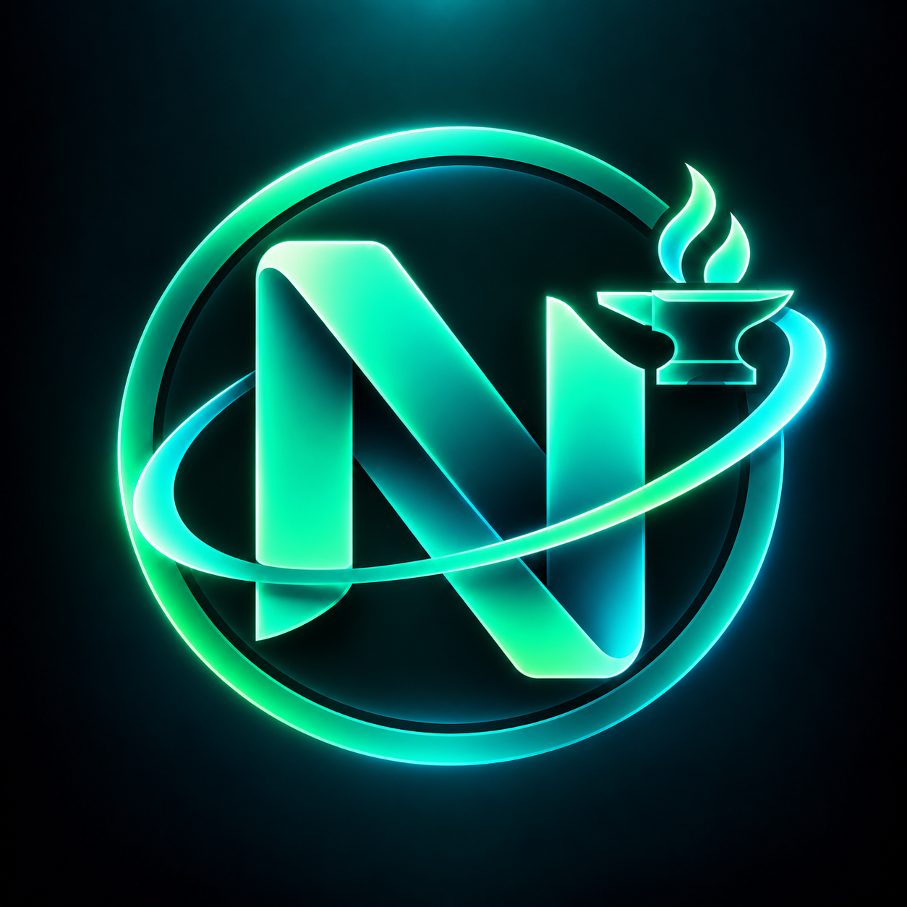

<p align="center">
  
</p>

<h1 align="center">Numera Skill Forge</h1>

<div align="center">

[](https://github.com/KiaroSama/Numera-Skill-Forge/actions/workflows/ci.yml)
[](LICENSE)
[](rust-toolchain.toml)
[](apps/desktop/tsconfig.json)
[](apps/desktop/src-tauri/Cargo.toml)
[](apps/desktop/package.json)
[](crates/forge-cli)
[](apps/desktop)
[](docs/architecture.md)
[](docs)
[](crates/forge-core/src/storage.rs)
[](docs/installation.md)
[](#donate)

</div>

Source-aware distribution and synchronization for coding-harness extensions: **Skills, Agents,
Commands, Settings, Hooks, MCPs, Mods and Plugins**, plus rules, workflows, tools, language tooling,
styles, UI extensions, themes, services, providers, channels, onboarding contracts and assets.

**Development preview, not a complete production release.** The current executable foundation
registers and inspects licensed Git sources, explicitly approves content, deterministically builds
skill packages, and performs receipt-based project skill installation/disable/enable/uninstall with
conflict checks and journal recovery. Broader native component adapters and platform runtime
certification remain in progress. A listed harness is not a claim that every component works there.

## Quick start

Source builds need Rust 1.99, Node 24, Git and [Tauri platform prerequisites](https://v2.tauri.app/start/prerequisites/).
The headless CLI does not require a webview. No LLM subscription or API key is required.

```powershell
cargo run -p forge-cli -- --repository . init
cargo run -p forge-cli -- --repository . source list
cargo run -p forge-cli -- --repository . harness list
cargo run -p forge-cli -- --repository . doctor --json
```

macOS/Linux use the same Cargo commands in their shell. Windows native usage does not require WSL.
WSL is a separate Linux environment: select its own workspace and destinations.

The initial registry contains **no active third-party sources**. Register only repositories you
approve; public availability alone is not a redistribution license. See [Adding content](docs/source-format.md).

## Easy additions

For an existing supported component/target profile, adding another skill/plugin is a registration
change, not an engine rewrite. Register its source, inspect its full companions and license, approve
the reviewed digest, then add a package record. New host APIs still require reviewed adapters/tests.

```powershell
numera-forge source add https://github.com/OWNER/REPOSITORY --id selected-source --root skills/selected
numera-forge discover selected-source --json
numera-forge approve selected-source --digest REVIEWED_DIGEST
numera-forge package add package.json
numera-forge build selected-package --target claude-code --locked
```

These placeholders are examples, not enabled sources. Executable content requires separate explicit
trust; `--yes` is not a trust bypass.

## Maintainer and consumer boundaries

Consumers do not need write access to this repository. Project installs require an explicit destination
and support dry-run. Configuration/native-runtime installation routes are distinct from skill copies.
Publication defaults to preview; local updates are not GitHub updates. No auto scheduler or daemon.
Launcher reopening checks enabled sources sequentially, with failed sources retaining accepted state.

## Documentation

- [Architecture and current limitations](docs/architecture.md)
- [Installation and CLI](docs/installation.md)
- [Source and package registration](docs/source-format.md)
- [Compatibility](docs/compatibility.md)
- [Verification](docs/testing.md)

## Reference repositories

See **[all reference repositories](docs/reference-repositories.md)** for the complete public link list,
separated into consulted contracts and unqualified example candidates. Listing is not source approval.

## Logs and privacy

Each application run writes a new UTF-8 UTC file under the selected workspace's local state log
directory, named `numera-forge_YYYY-MM-DD_HH-mm-ss_UTC.log` with collision-safe suffixes. Entries
contain UTC timestamps, INFO/WARNING/ERROR/DEBUG and categories. DEBUG is opt-in with `NUMERA_DEBUG=1`.
Commands/results go to stdout; diagnostics go to stderr/files. Credentials and raw upstream process
output are not logged. Telemetry is disabled. Review/redact logs before sharing; automatic support
bundles and configurable retention are not yet implemented.

## Donate

If this project helps you, donations are appreciated.

| Currency | Network | Address |
| --- | --- | --- |
| Bitcoin (BTC) | Bitcoin | `bc1qmth5m03pu5hujw5xw5jmywam3jj3sqwqupesdt` |
| USDT, BNB, USDC, etc. | BEP20 | `0x0Bd0BA443a8B9cf15922bf7f0Bb0a4b495fD06Ef` |
| USDT, TRX, USDC, etc. | TRC20 | `TWBA3xFTqgZAeAYMxqo85xWnzvty3DcAhw` |
| Ethereum (ETH) | ERC20 | `0x0Bd0BA443a8B9cf15922bf7f0Bb0a4b495fD06Ef` |
| TON | TON | `UQCN8Umo_OfOWqImZetQsrNStPcmLkMAKajFyiCOhso23NDb` |
| Litecoin (LTC) | LTC | `ltc1qntqnnrunadurnw4cshv3qgspywrueyyeyngwuy` |
| Solana (SOL) | Solana | `7B2wkczUjmkDhETwQuknBL8sUsbuV7nErxc317TmQuwR` |
| Polygon (POL) | Polygon | `0x0Bd0BA443a8B9cf15922bf7f0Bb0a4b495fD06Ef` |

## License

The existing [GNU GPL Version 3 license](LICENSE) is preserved. First-party code uses GPL-3.0-only;
third-party payloads keep their own licenses/notices and require reviewed redistribution rights.
