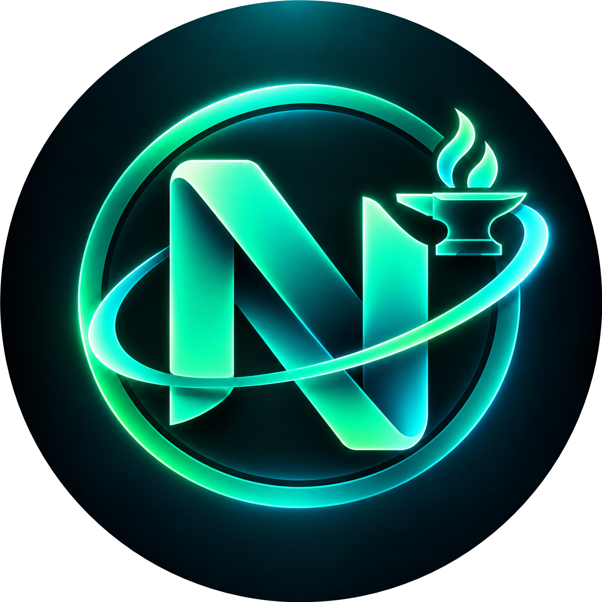

<p align="center">
  
</p>

<h1 align="center">Numera Skill Forge</h1>

<div align="center">

[](https://github.com/KiaroSama/Numera-Skill-Forge/actions/workflows/ci.yml)
[](LICENSE)
[](rust-toolchain.toml)
[](apps/desktop/tsconfig.json)
[](apps/desktop/src-tauri/Cargo.toml)
[](apps/desktop/package.json)
[](crates/forge-cli)
[](apps/desktop)
[](docs/architecture.md)
[](docs)
[](crates/forge-core/src/storage.rs)
[](docs/installation.md)
[](#donate)

</div>

Source-aware distribution and synchronization for coding-harness extensions: **Skills, Agents,
Commands, Settings, Hooks, MCPs, Mods and Plugins**, plus rules, workflows, tools, language tooling,
styles, UI extensions, themes, services, providers, channels, onboarding contracts and assets.

**Development preview, not a complete production release.** The current executable foundation
registers and inspects licensed Git sources, explicitly approves content, deterministically builds
dependency-closed packages, and performs receipt-based project/user installation, managed JSON
configuration merging, disable/enable/uninstall and mode-preserving journal recovery. Broader native component adapters and platform runtime
certification remain in progress. A listed harness is not a claim that every component works there.

## Quick start

Source builds need Rust 1.99, Node 24, Git and [Tauri platform prerequisites](https://v2.tauri.app/start/prerequisites/).
The headless CLI does not require a webview. No LLM subscription or API key is required.

```powershell
cargo run -p forge-cli -- --repository . init
cargo run -p forge-cli -- --repository . source list
cargo run -p forge-cli -- --repository . harness list
cargo run -p forge-cli -- --repository . doctor --json
```

macOS/Linux use the same Cargo commands in their shell. Windows native usage does not require WSL.
WSL is a separate Linux environment: select its own workspace and destinations.

## First skill collection

Forge currently accepts **812 reviewed packages** from
[davila7/claude-code-templates](https://github.com/davila7/claude-code-templates): 808 independent
marketplace plugins and four required-native DoorDash bundles delivered through explicit Forge approval. Original prompts, scripts, companions and notices are preserved; 41 explicitly reviewed
entries normalize only their frontmatter name and matching directory, retaining the original entry
and exact change provenance. This is a bounded licensed subset, not the entire upstream collection.
See [licenses, additions and exclusions](docs/source-licenses.md).

```bash
claude plugin marketplace add KiaroSama/Numera-Skill-Forge
```

```bash
claude plugin install skill-creative-design-frontend-design@numera-skill-forge
```

Installing/enabling a skill is separate consent; some skills contain scripts or use external services.
Forge never executes imported code to inspect, package or synchronize it.

## Separate additional collections

Three independent plugins bring the initial marketplace total to **488**; the existing 485-plugin collection
above remains unchanged. Each retains the original skill, every in-root companion and its MIT notice.

| Collection | Skill | Independent plugin |
| --- | --- | --- |
| [JCodesMore website cloner](https://github.com/JCodesMore/ai-website-cloner-template) | `clone-website` | `skill-jcodesmore-clone-website` |
| [morluto REA](https://github.com/morluto/rea) | `reverse-engineer-anything` | `skill-morluto-reverse-engineer-anything` |
| [newliver666 APK reverse](https://github.com/newliver666/apk-reverse) | `apk-reverse` | `skill-newliver666-apk-reverse` |

```bash
claude plugin install skill-jcodesmore-clone-website@numera-skill-forge
```

```bash
claude plugin install skill-morluto-reverse-engineer-anything@numera-skill-forge
```

These are instruction packages, not copies of the upstream applications. REA's skill does not
register its MCP server, install analysis engines or include a commercial-tool license. Its external
runtime/tool prerequisites remain separate. The two repository-specific REA maintainer skills are
not included. APK reverse retains its original references, scripts and evidence files; Python,
Android SDK, ADB and Frida requirements depend on the selected analysis route and are not installed
by Forge. Use only on owned or authorized samples. All three selected collections use the same
check/apply, accepted-revision and review-only update rules below; a change requiring review retains
the accepted version.

```bash
claude plugin install skill-newliver666-apk-reverse@numera-skill-forge
```

## Complete K-Dense scientific collection

All **177 original skills** from [K-Dense-AI/scientific-agent-skills](https://github.com/K-Dense-AI/scientific-agent-skills)
are included as independent packages. Together with the reviewed additions, Forge now accepts
**1146 packages**: **1142 ordinary marketplace plugins** and **four Forge-only required-native bundles**. The [107 missing-root additions](docs/missing-skill-imports.md) include approved
name-only adaptations, complete original-source packages, transparent guide adapters and reviewed
layout/license-compliance repairs. The latest35 preserve all1110 preceding accepted objects.
Forty-six canonical roots remain held for exact source/grant conditions; Animate UI is additionally
listed as a source reference pending clarification of its custom redistribution terms. K-Dense original names,
complete companions and MIT notices are preserved at reviewed revision `a1043ef`; the earlier 488
packages are unchanged. Each package ID is `skill-kdense-<original-name>`; browse
[the catalog](catalogs/collections.json) for the complete list.

```bash
claude plugin install skill-kdense-statistical-analysis@numera-skill-forge
```

Use the same [host setup and lifecycle commands](docs/host-setup.md) for every supported host.
This collection has its own source/update identity. Scientific dependencies, cloud services, API
credentials, datasets and GPU tools are not installed or executed by Forge. Packages with matching
original names from different sources remain distinct; a conflicting standalone installation refuses
rather than overwriting the other source. Packaging is not scientific or clinical validation.

## Reverse and CTF source additions

The complete42-skill CTF Sandbox Orchestrator family from
[zhaoxuya520/reverse-skill](https://github.com/zhaoxuya520/reverse-skill) is available as one
original dependency-complete bundle, retaining every sibling skill, reference and native invocation
policy plus its original setup dependencies. Two appended path-repair notices preserve exact originals
separately; bundled setup scripts remain inactive. Its GPLv3 scope and credited original MIT/CC0 notices remain intact; the1145previous packages
are unchanged.

```bash
claude plugin install skill-reverse-ctf-sandbox@numera-skill-forge
```

Use the original `ctf-sandbox-orchestrator` entry; competition children are downstream-only. Packaging
does not activate it or authorize any target. Its original assumption that supplied targets are sandbox
assets is not evidence of ownership: confirm actual authorization before any active test.
The full reverse-skill router remains held for copied-corpus provenance, and the separately requested
Codeberg APK source is access-blocked. The47earlier holds were freshly checked without a new complete
grant; see [exact source outcomes](docs/remaining-skill-disposition.md#additional-requested-reverse-sources).

## Vercel skills and design references

All **nine original Vercel skills** are included from reviewed revision `063bee94`, as
`skill-vercel-<source-directory>` packages: composition patterns, deployment, React best practices,
React Native, View Transitions, CLI tokens, optimization, web design guidelines and writing guidelines.
Their **304 original files**, including the deployment archive and all companions, retain exact bytes
and nine executable modes. The previous 945 package records remain unchanged. For example:

```bash
claude plugin install skill-vercel-react-best-practices@numera-skill-forge
```

The [VoltAgent DESIGN.md collection](https://github.com/voltagent/awesome-design-md) now provides
**84 independently installable design skills/plugins**. Each `skill-voltagent-design-<name>` package
contains a Forge-generated `SKILL.md`, the unchanged original design document, complete companions,
MIT notice and visual-identity disclaimer. These are explicitly adapted references, not upstream-native
skills or permission to copy brands, proprietary fonts or assets. For example:

```bash
claude plugin install skill-voltagent-design-voltagent@numera-skill-forge
```

See [source details and limits](docs/source-licenses.md#vercel-original-skills-and-voltagent-references)
and the [explicit design review, acceptance and update workflow](docs/design-updates.md).

## Other hosts: native catalogs and standalone skills

The same original collection packages can be selected for Codex, Cursor, Antigravity desktop,
OpenCode v1/v2, Hermes and the remaining documented skill hosts. Root native catalogs retain
independent package identities; standalone delivery uses Forge's scoped ownership/lifecycle engine.
Read the **[host-by-host installation and setup guide](docs/host-setup.md)** for exact paths,
commands, trust/restart steps, updates/removal and duplicate-name/runtime limitations.
Only the four explicitly approved name-only adaptations differ from original activation names;
native runtime-only profiles are not replaced by skill copies.

## Manual and local updates

[Collection synchronization](docs/upstream-sync.md) starts manually in GitHub Actions; no schedule,
push or pull request starts verification automatically. Safe reviewed prompt updates are rebuilt and pushed; script, license,
file-structure and executable-mode changes require review. The local [run.ps1](run.ps1) launcher
checks by default; `-Apply` updates accepted collection files, never installs extensions into a host.

```powershell
./run.ps1 -Check -Build
```

```powershell
./run.ps1 -Apply
```

Register additional repositories only after approval; public availability alone is not a redistribution
license. See [Adding content](docs/source-format.md).

## Easy additions

For an existing supported component/target profile, adding another skill/plugin is a registration
change, not an engine rewrite. Register its source, inspect its full companions and license, approve
the reviewed digest, then add a package record. New host APIs still require reviewed adapters/tests.

```powershell
numera-forge source add https://github.com/OWNER/REPOSITORY --id selected-source --root skills/selected
numera-forge discover selected-source --json
numera-forge approve selected-source --digest REVIEWED_DIGEST
numera-forge package add package.json
numera-forge build selected-package --target claude-code --locked
```

These placeholders are examples, not enabled sources. Executable content requires separate explicit
trust; `--yes` is not a trust bypass.

## Maintainer and consumer boundaries

Consumers do not need write access to this repository. Project installs require an explicit destination
and support dry-run. Configuration/native-runtime installation routes are distinct from skill copies.
Publication defaults to preview; local updates are not GitHub updates. No auto scheduler or daemon.
Desktop reopening checks enabled sources sequentially, with failed sources retaining accepted state.
Sources exposes explicit per-source update policy and enabled-state controls, with reviewed confirmation.
Settings can separately opt into policy-approved safe updates and rebuilds on open; it never installs or
publishes. Generic builds emit target catalogs and a separate Claude marketplace without changing the
collection-owned repository marketplace; native manifest identities and user-edited outputs are preserved. Installed updates coordinate all enabled owners per destination and preserve user changes.
Persisted per-step progress supports inspection/cancellation and failed-only retry.

The remaining-skill review added164 complete packages;135 have explicit source, notice or technical
blockers. See the [complete299-root disposition](docs/remaining-skill-disposition.md). Original
upstream stubs and separately installed prerequisites are disclosed; packaging never executes them.

## Documentation

- [Architecture and current limitations](docs/architecture.md)
- [Installation and CLI](docs/installation.md)
- [Source and package registration](docs/source-format.md)
- [Compatibility](docs/compatibility.md)
- [Verification](docs/testing.md)
- [Controlled Linux CI inputs](docs/ci-input-contract.md) — prospective Core/CLI and frontend input enforcement, evidence, trust boundaries and limitations.

## Reference repositories

See **[all reference repositories](docs/reference-repositories.md)** for the complete public link list,
separated into consulted contracts and unqualified example candidates. Listing is not source approval.

## Logs and privacy

Each application run writes a new UTF-8 UTC file under the selected workspace's local state log
directory, named `numera-forge_YYYY-MM-DD_HH-mm-ss_UTC.log` with collision-safe suffixes. Entries
contain UTC timestamps, INFO/WARNING/ERROR/DEBUG and categories. DEBUG is opt-in with `NUMERA_DEBUG=1`.
Commands/results go to stdout; diagnostics go to stderr/files. Credentials and raw upstream process
output are not logged. Telemetry is disabled. Review/redact logs before sharing; automatic support
bundles are local-only (`support`, logs opt-in); `log-retention` previews by default and requires
`--apply` to remove older logs while retaining the requested newest files.

## Donate

If this project helps you, donations are appreciated.

| Currency | Network | Address |
| --- | --- | --- |
| Bitcoin (BTC) | Bitcoin | `bc1qmth5m03pu5hujw5xw5jmywam3jj3sqwqupesdt` |
| USDT, BNB, USDC, etc. | BEP20 | `0x0Bd0BA443a8B9cf15922bf7f0Bb0a4b495fD06Ef` |
| USDT, TRX, USDC, etc. | TRC20 | `TWBA3xFTqgZAeAYMxqo85xWnzvty3DcAhw` |
| Ethereum (ETH) | ERC20 | `0x0Bd0BA443a8B9cf15922bf7f0Bb0a4b495fD06Ef` |
| TON | TON | `UQCN8Umo_OfOWqImZetQsrNStPcmLkMAKajFyiCOhso23NDb` |
| Litecoin (LTC) | LTC | `ltc1qntqnnrunadurnw4cshv3qgspywrueyyeyngwuy` |
| Solana (SOL) | Solana | `7B2wkczUjmkDhETwQuknBL8sUsbuV7nErxc317TmQuwR` |
| Polygon (POL) | Polygon | `0x0Bd0BA443a8B9cf15922bf7f0Bb0a4b495fD06Ef` |

## License

The existing [GNU GPL Version 3 license](LICENSE) is preserved. First-party code uses GPL-3.0-only;
third-party payloads keep their own licenses/notices and require reviewed redistribution rights.
